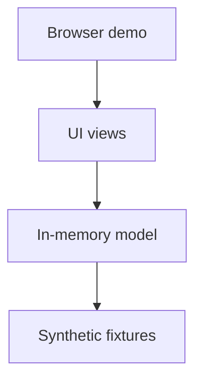

# Showcase architecture

The demonstration is intentionally isolated:

- `demo/index.html` — accessible document shell.
- `demo/styles.css` — responsive visual system and interaction states.
- `demo/icons.mjs` — self-contained, consistently stroked Lucide SVG icons with license notices.
- `demo/sample-data.mjs` — obviously fictional fixtures; no real records.
- `demo/model.mjs` — pure, testable state transitions and filters.
- `demo/app.mjs` — rendering and user interaction.
- Guided four-step workflow — an in-memory reception, call, sample chart, and completion sequence.
- `tests/` — invariants for in-memory transitions, synthetic fixtures and public-content boundaries.

**There is no server-side component in this public codebase.** The real product's backend and security-sensitive architecture are intentionally omitted. The diagram describes this showcase only, not deployment topology.
